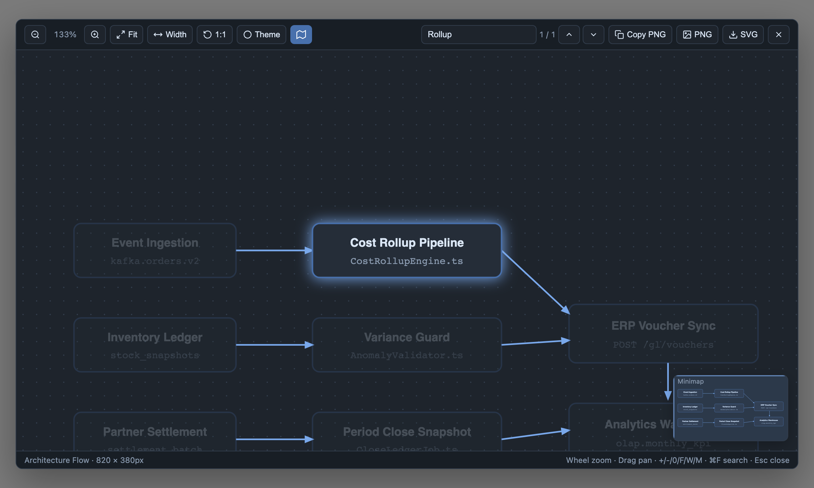
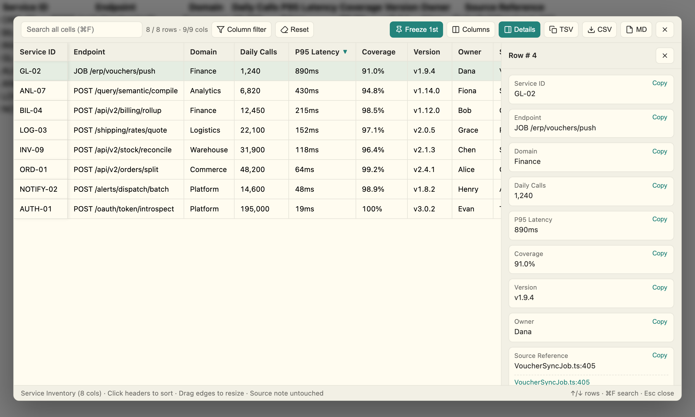

# Qing Shan Workbench

**青山 · 图表与宽表工作台** — Interactive Mermaid diagram lightbox and virtualized wide-table workbench for large technical notes.

Built as a standalone companion to [Qing Shan Typography](https://github.com/LaityAway/obsidian-qing-shan-typora), working cleanly with any theme across desktop, popout windows, and mobile (`isDesktopOnly: false`) without ever modifying your Markdown files.





## Features

### Mermaid Immersive Lightbox
- **60fps GPU pan & zoom (`10%–800%`)**: Pointer-centered wheel zoom, touch pinch-to-zoom, Fit / Fit Width / 1:1 controls, and keyboard shortcuts (`+`, `-`, `0`, `F`, `W`, `M`, `Cmd/Ctrl+F`, `Esc`).
- **Interactive Minimap**: Real-time viewport indicator in the bottom-right corner with click/drag panning for huge `erDiagram` and `flowchart` canvases.
- **In-diagram Node Search**: Indexes both SVG `<text>` and `<foreignObject>` HTML labels, dims unrelated nodes, highlights matches, and smoothly centers each result with `Enter` / `Shift+Enter`.
- **High-Fidelity Export (SVG & 2×/3× Retina PNG)**:
  - Rewrites scoped `#mermaid-*` IDs and inlines computed styles (preserving `fill: none` on curved edges) so exported diagrams look identical outside your vault.
  - Supports **Theme**, **Pure White**, and **Transparent** backgrounds — including **luminance-aware Dark-to-White adaptation** that automatically converts bare dark-mode labels and pale connectors to WCAG AA+ contrast on white paper while preserving light text inside dark node boxes.
  - Safely clamps oversized diagrams to browser canvas limits (`8192px`) and gracefully falls back to file download if clipboard image write is unavailable.

### Virtualized Wide-Table Workbench
- **Reading View Inline Enhancement**: Activates only when a table exceeds configurable thresholds (default `≥ 5` columns or `≥ 12` rows), keeping small tables untouched. Includes a sticky quick filter bar, sticky header & first-column toggle, one-click TSV copy, and fullscreen launch.
- **Zero-Conflict Live Preview**: Places a subtle read-only trigger safely offset from the native `</>` edit icon without touching CodeMirror cells or editing flow.
- **Virtualized Fullscreen Grid**: Handles 1,000–10,000+ row tables smoothly via windowed rendering (`< 40` mounted DOM rows during scroll), automatic multi-type sorting (numbers, currency/units, percentages, dates, semantic versions, Chinese/English locale with empty values anchored last), global & per-column filtering (supports `!exclude`), column visibility picker, drag-to-resize columns (double-click to reset), and keyboard row navigation (`↑` / `↓`).
- **Row Detail Drawer**: Click any row to inspect all columns vertically (including hidden columns) with per-field one-click copy and clickable internal `[[wikilinks]]`.
- **Clean Multi-Format Export**: Copy TSV (paste directly into Excel / Sheets / DingTalk / Feishu), download UTF-8 BOM CSV (Excel-safe CJK), or copy filtered Markdown sub-tables.

### Safety, Isolation & Privacy
- **Zero note mutation**: Never writes to your Markdown files.
- **Zero network requests / zero telemetry**: Everything runs 100% locally in memory.
- **Configurable exclusions**: Add sensitive folder prefixes in Settings (e.g., `Secrets/`, `Credentials/`), or exempt individual notes with frontmatter `cssclasses: [qs-off]` or `qs-no-workbench`. Automatically skips `.bases-view`, `[data-password-toggle]` tables, and hides all controls during print / PDF export.

## Installation

### Community plugins
Once approved in the Community Directory:
1. Open **Settings → Community plugins → Browse**.
2. Search for **Qing Shan Workbench** (or **青山**).
3. Install and enable the plugin.

### Manual
1. Download `main.js`, `manifest.json`, and `styles.css` from the [latest GitHub release](https://github.com/LaityAway/obsidian-qing-shan-workbench/releases/latest).
2. Place them in `<vault>/.obsidian/plugins/qing-shan-workbench/`.
3. Reload plugins and enable **Qing Shan Workbench**.

## Commands

- `Open diagram / wide-table picker for active note` — Pick any Mermaid diagram or table in the current note without relying on hover.
- `Toggle Mermaid lightbox` — Instantly enable or disable Mermaid lightbox triggers across all open views.
- `Toggle wide-table workbench` — Instantly enable or disable wide-table enhancements across all open views.

## 中文简介

**青山 · 图表与宽表工作台**是一款零侵入、不改动笔记原文的独立插件，支持桌面端、多窗口与移动端：
- **Mermaid 沉浸式灯箱**：60fps 指针中心缩放/拖拽与双指捏合、右下角可拖拽小地图、图内节点搜索居中、深色切纯白底自动 WCAG 对比度适配，以及高保真内联样式 `.svg` 与 2×/3× 高清 `.png` 复制导出。
- **千行级宽表工作台**：阅读视图按行列阈值自动增强（小表不打扰），实时预览零干涉单元格编辑；全屏工作台支持虚拟滚动、智能多类型排序（数值/货币/百分比/日期/版本号/中文）、全表与列级 `!排除` 筛选、列显隐与调宽、单行竖排详情抽屉（支持双链跳转与单字段复制）以及 TSV / UTF-8 BOM CSV / Markdown 子表导出。
- **隐私与隔离**：纯本地运行、零网络请求；支持在设置中配置排除目录及单笔记 `qs-off` / `qs-no-workbench` 豁免，打印与 PDF 导出自动隐藏全部交互控件。

## Development

```bash
npm install
npm run typecheck
npm run build
npm test
```

## License

[MIT](LICENSE)
